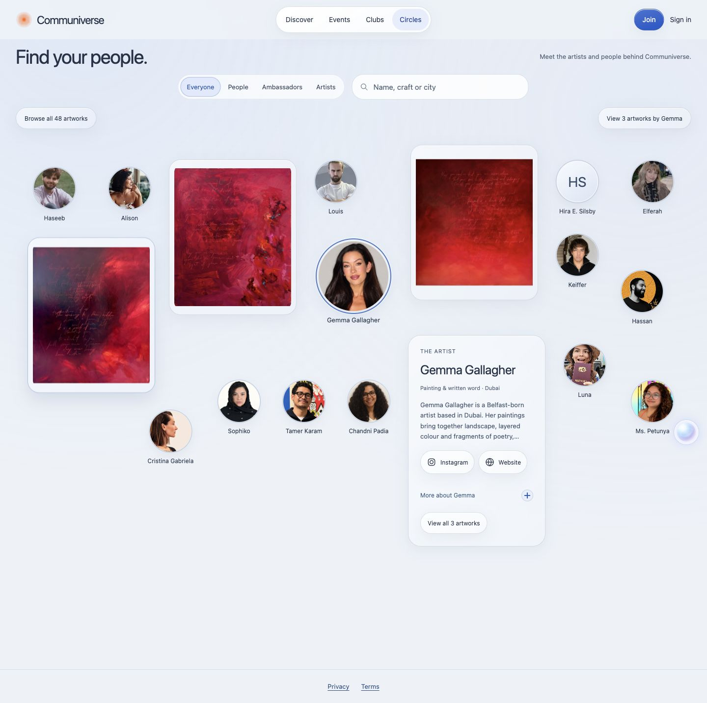

# Circles artwork visibility and quieter motion

Gemma's live Circles data contains Light of Your Soul, Beloved and All Along. All three original image URLs returned HTTP 200. The live canvas placed two below a 1280x720 viewport; the collection had not been deleted. All six artists retain 48 works: Gemma 3, Chandni 11, Tamer 26, Sophiko 2, Ms. Petunya 1 and Cristina 5.

This follow-up is based on integration PR #44 and the [reconciled runtime map](recon.md). It is a local preview revision. The public v25 release and previously staged A-K candidate are unchanged. No Cloudflare version promotion or account cutover is included.

The revision adds a persistent Browse all 48 artworks link and a selected artist's complete-portfolio link with a count. The portfolio destination has a working artwork-section anchor. Artwork receives placement priority over the biography while preserving image-only artwork cards, the clicked portrait anchor, upright frames, outside-click/Escape behavior and collision gutters.

Opening an artwork previously rebuilt all its artist's cards, faded the entire panel, and scaled images and portraits. The revision retains the existing artwork/about nodes and uses only a 140ms opacity reveal for new story content. It removes scene-wide movement/fading and animated image/portrait scaling. Hover retains subtle outline feedback without lifting cards. Resting portrait positions are restored after closing artwork, and scrolling no longer changes the canvas's layout-height calculation.

Build and lint pass; all 39 tests pass. A new runtime regression verifies all 48 distinct work IDs, Gemma's three exact titles, initial-HTML portfolio navigation and destination. Browser checks cover all six portfolios at 375px and 1440px with no collisions or horizontal overflow. Gemma's three images load; their DOM identity and the biography remain intact through all three open/close interactions. Portrait positions return exactly to their original coordinates after those interactions. Reduced motion produces no canvas animations. Axe reports zero automated violations on Gemma's circle and portfolio at both widths; gradient contrast remains a manual review item.

[Geometry](evidence/circles-refinement/geometry.json), [motion](evidence/circles-refinement/motion.json), [position restoration](evidence/circles-refinement/stability.json) and [axe](evidence/circles-refinement/axe.json) record local browser evidence. Existing legal, content, sharing-image, live form delivery and account/provider release gates remain in force.

