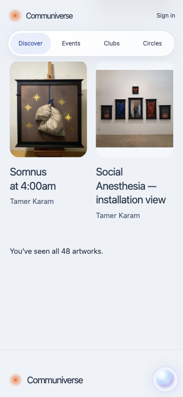

# Infinite artwork scrolling

The user selected Home and Works. This follow-up is based on Circles refinement #45 and the [reconciled runtime map](recon.md). It changes the local candidate source only. Public v25, the earlier zero-percent candidate and account cutover are unchanged.

Home already has automatic cursor loading. Browser verification at 375px and 1440px reaches all 45 eligible works with 45 unique IDs. Artist balancing and the three Home-only exclusions remain unchanged.

Artwork titles use dark slate, artist names use muted slate, and artwork-card links have no resting underlines. Keyboard focus outlines and link behavior are retained. Inline prose links keep their visual distinction.

Works now progressively appends 18, 36 and then all 48 artworks as the visitor approaches the bottom. It interleaves artists without applying Home exclusions. The current catalogue remains in initial HTML, so script failure or disabled JavaScript leaves all records available. Only the enhanced browser view queues later batches; images retain native lazy loading. This bounded 48-work catalogue does not require another API or database read for each batch.

The loading-point observer re-arms after appending, including when a fast scroll leaves it visible. Manual loading remains available as a keyboard/browser fallback. Search performs normal navigation and starts a fresh filtered collection; Gemma's three results immediately reach their end state. The observer disconnects at the end or on page hide and reconnects for restored browser pages. No cards repeat, no new motion is introduced and focus is preserved during automatic loading.

Build/lint and all 41 tests pass. Tests verify artist interleaving, retention of Home-excluded records in Works, all 48 distinct initial-HTML work links, filtered/empty results and the delivered client. Original source/asset hashes pass. Publication scan covers 591 files with zero findings.

Browser checks at 375px and 1440px confirm Works loads 18 → 36 → 48, retains 48 unique IDs and remains at 48 after additional scrolling. A manual-fallback browser check reaches the same counts. Home reaches 45 unique works. Neither page overflows horizontally. Axe reports zero automated violations in the fully expanded Works view at both widths; gradient contrast remains a manual review item.

Evidence: [Works](evidence/infinite-scroll/works-checks.json), [Home](evidence/infinite-scroll/home-checks.json), [fallback/search](evidence/infinite-scroll/fallback.json), [axe](evidence/infinite-scroll/axe.json). Existing legal/content inputs, visual approval, real CAPTCHA/email acceptance and D1/provider gates remain outstanding. No Cloudflare promotion, billing, DNS, authentication, database-policy or storage changes are included.

