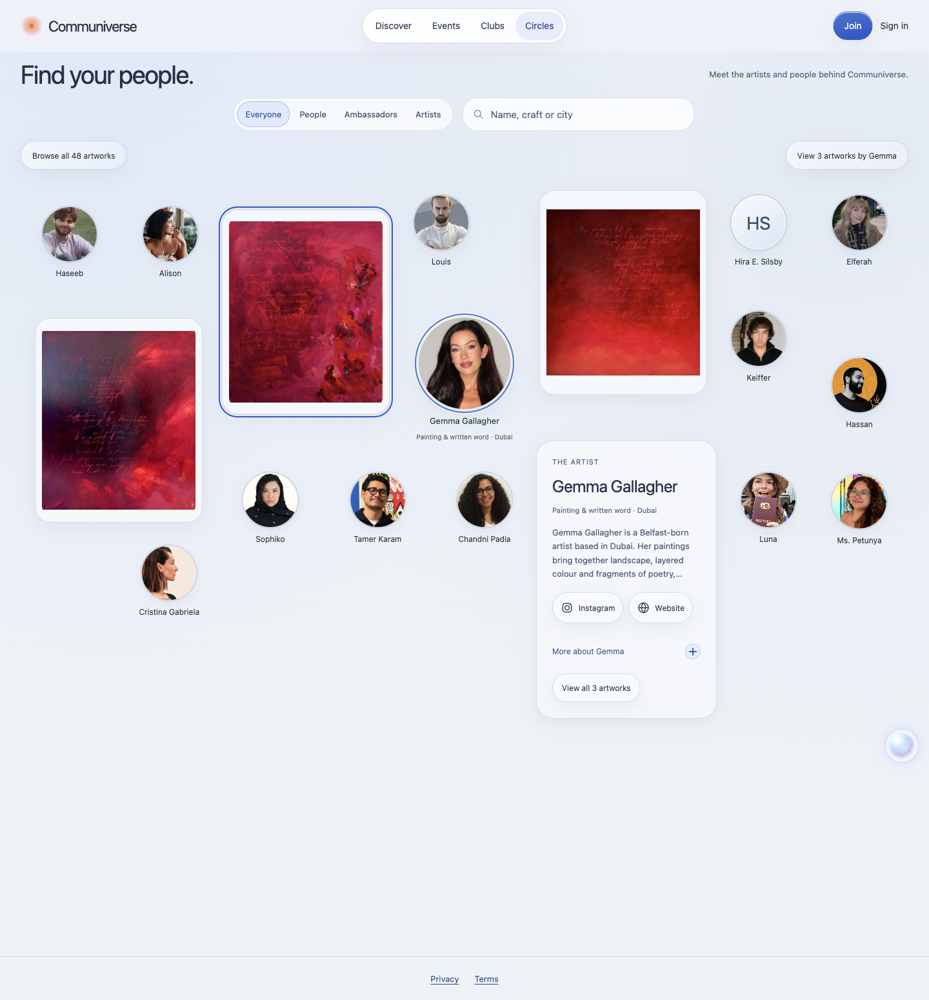
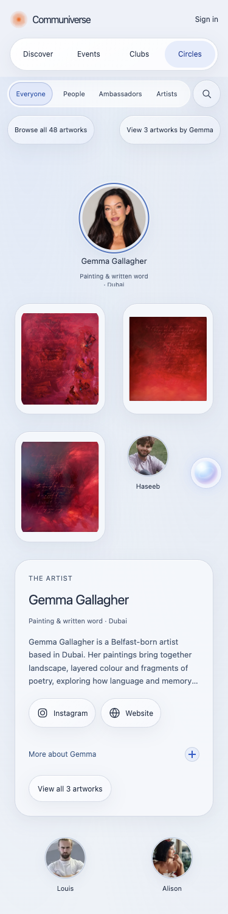

# Circles surrounding cards

The selected portrait remains at the clicked location. Its artwork and background appear immediately in separated upright cards, matching the supplied Communiverse reference. Connecting lines are removed. Wide screens use a stable editorial field; narrow screens keep readable circles and paired artwork cards with a measured gutter. Additional works extend the document instead of shrinking or discarding the collection.

This changes the public presentation inherited from PR #49 and the [reconciled runtime map](recon.md). The original 146 retained modules, 321 public assets, existing account/mutation runtime and all six artists' 48 works remain. The client release is `public-domain-20261030-v29`, so previous immutable asset URLs are not overwritten. D1 remains the account backend; Supabase is audit-only. No account cutover, provider configuration, billing, DNS, database schema or policy changes are included.

Both builds, syntax checks and all 53 tests pass. Browser checks cover all six artists at 375px and 1440px: correct work counts, round portraits, no entity collisions and no horizontal overflow. Gemma's three actual paintings load. Artwork selection reveals its story and canonical page link while retaining the original artwork and background DOM nodes. Closing the story restores portrait positions. Hover reveals the role with a local outline highlight; outside-click deselects; the clicked portrait center remains unchanged. Reduced motion produces zero canvas animations. Axe finds zero automated violations in Circles content at both widths, with translucent-background contrast left for manual review.

The first local preview encountered cloud-only placeholders in the Documents checkout. Verification continued from a fresh checkout of the exact parent commit and copied only the reviewed changed files. Public images were read from their existing production URLs in the temporary preview. The shipped Worker does not contain that local proxy.

[Browser evidence](evidence/surrounding-cards/browser-verification.json) records geometry and interaction results. Required human inputs for this presentation change: visual review. Existing legal, workshop, portrait, sharing-image and account/provider inputs remain separate.

