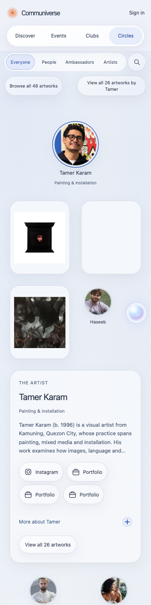

# Three artwork previews and responsive Circles motion

Circles now renders at most three artwork cards in initial HTML and in the interactive scene. The catalogue still contains all six artists and 48 works. The full-portfolio links retain complete collections, including Tamer's 26 works. A direct link to another artwork replaces the third preview slot instead of creating a fourth card. Existing artwork/background nodes are reused when opening and closing a story.

The public presentation follows PR #50 and the [reconciliation map](recon.md). Release `public-domain-20261030-v30` changes no account, mutation, database, provider, billing or DNS behavior. D1 remains the backend and Supabase remains audit-only. The original 146 retained modules, 321 public assets and 21 bindings remain.

Selection and card changes use native, interruptible Web Animations. Existing circles travel for 320ms when their corridor is clear. Where a path could cross another entity, the target settles locally within 8px of its reserved position. The corridor calculation accounts for the selected portrait's enlarged dimensions. New cards reveal over 220ms, with at most 48ms of staggering. Portraits scale uniformly and compensate for the parent translation, keeping their circular shape. Hover/focus lifts use CSS; there is no continuous idle animation or scroll-driven reflow. A repeated input captures the currently rendered positions before cancelling the previous animations. Semantic state changes immediately. Reduced motion cancels animations and uses the final state.

Both builds, lint and 55 tests pass. Tests cover the preview cap, complete catalogue, direct artwork links, corridor protection, portrait growth and retargeting. Browser checks cover all six artists at 375px and 1440px: preview counts are 1,3,3,2,3,3 against complete collections of 1,11,26,2,5,3. There are no resting collisions or horizontal overflow. Sampled rapid-click frames remain separated and circular on desktop and phone, including a 4x CPU-throttled emulation. Animations are active during interrupted input and settle afterwards. This is emulated testing, not a real-device frame-rate guarantee.

A direct link to Tamer's last artwork still shows only three preview cards. Reduced motion produces zero canvas animations. Opening an artwork preserves the original artwork and background nodes. Scrolling preserves document positions and canvas height. Tamer's three actual preview images load. Axe reports zero automated violations in desktop Circles content; contrast on translucent surfaces remains a manual review item.

[Browser evidence](evidence/three-work-motion/browser-verification.json) records the checks. Existing legal, content, sharing-image and account-provider inputs remain separate. No new human input is required for the requested preview/motion change.

